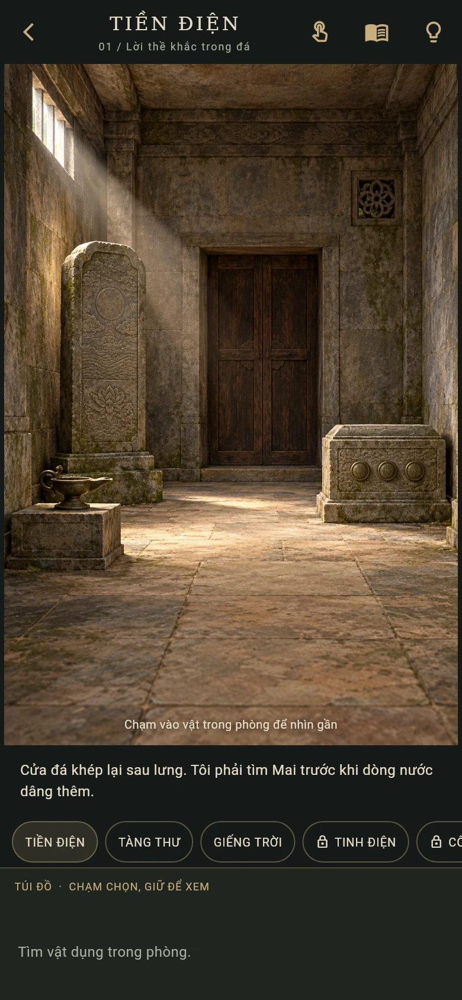
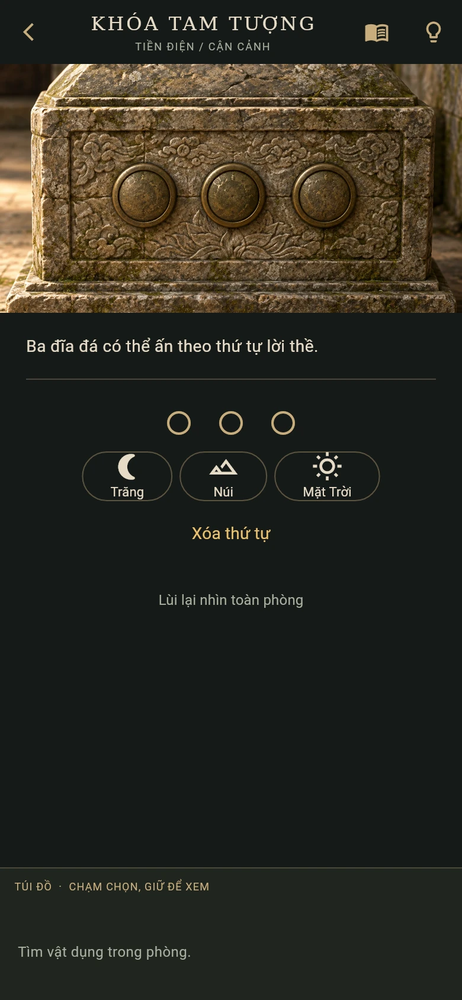

# Imperial Tomb — Lăng Mộ Không Tên

An original offline Flutter escape mystery in Vietnamese. A conservator follows her missing sister into a royal tomb and discovers a hydraulic machine built to hide a historical crime. Inspired by the quiet exploration and tactile puzzle design of Rime / Garden; story, rooms, clues and solutions are original.

## Version 0.2: art and deeper exploration

- **Six illustrated rooms:** Tiền điện, Tàng thư, Giếng trời, Tinh điện, Công phòng and Thủy môn.
- **25 closeups:** tap an object to zoom in, inspect its details and operate its mechanism.
- **Eight mechanisms:** ordered stone seals, ledger lock, compass lotus, concentric mirror rings, orrery, constrained counterweights, a connected pipe network and three-channel pressure regulation.
- **Five item recipes**, reusable tools, environmental restoration and persistent installed parts.
- Evidence crosses rooms: clean and illuminate a mural, restore a mirror, reveal erased names, take a rubbing, repair a pump, assemble a wheel and safely reroute water.
- Three endings, two-tier context hints, an evidence journal and autosave including partial mechanism positions. Existing v1 saves migrate.
- Original 1024 × 1536 backgrounds, optimized locally bundled WebP images, unobtrusive optional hotspot markers and exact code-rendered puzzle markings.

First-play pacing **target: 40–70 minutes**, pending human playtests. This is a playable expanded chapter, not a store-ready release. No backend, account, tracking, ads or runtime image downloads.

| Room view | Inspecting a mechanism |
| --- | --- |
|  |  |

## Run

Install Flutter and the device tooling, then generate platform runners once:

```sh
flutter create --project-name imperial_tomb --platforms=android,ios,web .
flutter pub get
flutter run
```

For iOS use macOS, Xcode and signing. Android physical devices require USB debugging. Platform runner directories are generated locally; source, assets and game rules are committed.

```sh
flutter analyze
flutter test
flutter build web --no-web-resources-cdn
```

## Play

Tap room objects to enter closeups. The hand/eye button reveals targets. Select an inventory item then tap **DÙNG…** in the closeup to apply it. Hold an item or tap its info button to examine it. To combine, select an item, tap **GHÉP**, then select the other component. Dials advance by tapping; **VẬN HÀNH** tests them. The journal records clues; the first hint nudges, the second gives the solution.

## Design and validation

- [Full walkthrough and endings](docs/WALKTHROUGH.md) — spoilers
- [Story, dependency graph and pacing](docs/STORY.md)
- [Art direction, asset states and validation notes](docs/ART_AND_QA.md)
- [Reproducible illustration prompts](docs/art-prompts.json)
- [Pure game rules](lib/game/game_session.dart)

Source and original game content are reserved to the repository owner until they select a license.
