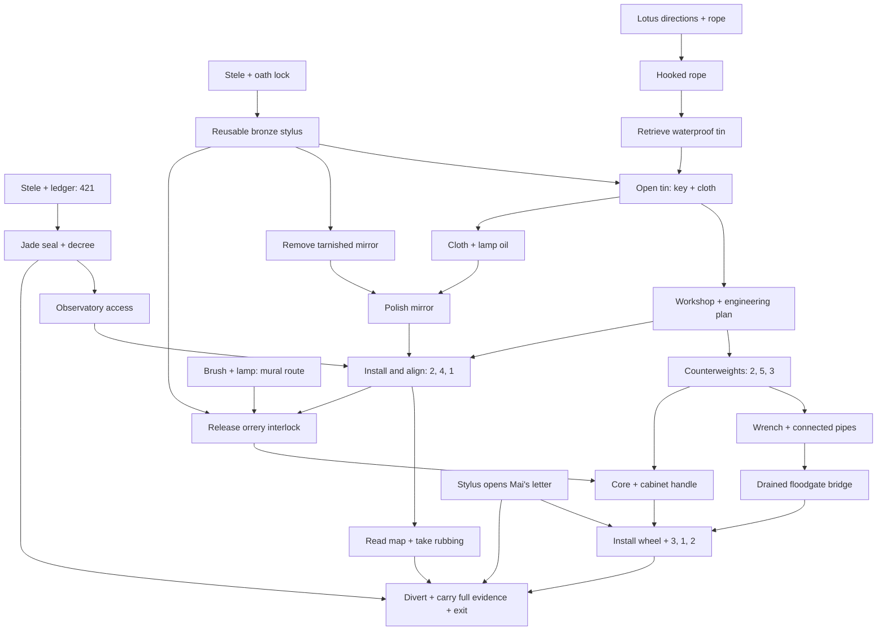

# Imperial Tomb — narrative and puzzle architecture, v0.2

## Premise and truth

An, a conservator, follows her vanished sister Mai into a sealed royal tomb. Mai's last warning is “Đừng mở cửa của nhà vua.” The apparent escape door is a flood release; the mausoleum conceals a hydraulic station.

The court once diverted a flood onto Đông Lâm, Vạn Khê and Hạ Thủy to save the capital, then erased their names and disguised the station as a tomb. Engineers left a safe alternate river channel. Mai found the evidence, left tools and a waterproof box, and entered the eastern service tunnels. There is no supernatural explanation.

## Reveal ladder and pacing

| Act | Space | Player's belief changes | Action and intended time |
| --- | --- | --- | --- |
| I | Tiền điện / Tàng thư | A tomb contains water ledgers and royal administration instead of burial goods. | Oath lock, cross-room ledger, restoration: 8–12 min |
| II | Giếng trời / Công phòng | Mai was here recently and deliberately protected tools from water. | Lotus, rope assembly, retrieve and open tin, engineer rules: 10–15 min |
| III | Tinh điện / archive return | Villages were erased from the map; the sky machine is a control interlock. | Restore mirror, align light, take rubbing, install axis: 12–20 min |
| IV | Workshop / Thủy môn | Escaping and preventing another flood are separate choices. | Balance, repair pipes, assemble wheel, regulate pressure: 10–20 min |

These are design allocations, **not measured playtest results**. Target 40–70 minutes without solutions. No timers, random locks, repeated key collection or forced waits pad the duration. Returning to rooms is useful because new tools reveal new information.

## Dependency graph

## Fair-play clues

| Mechanism | Available clue | Solution / physical rule | Reward |
| --- | --- | --- | --- |
| Stone oath | Stele names three figures in order | Sun → Mountain → Moon | Bronze stylus |
| Ledger chest | Fleet I and III in archive; Fleet II on stele | 421 in I–II–III order | Seal, decree |
| Lotus relief | Roots south, bud east, stem north, leaf west | South → East → North → West | Iron hook |
| Mirror rings | Engineer plan specifies outer, middle, inner; eight clockwise marks | 2–4–1 | Erased map, safety interlock |
| Orrery | Brush then lamp reveal a route on mural; axis missing | Install stylus; Moon → River → Sun | Valve core |
| Counterweights | Middle = left + right; right = left + 1; total = 10 | 2–5–3 (unique in 1..6) | Handle, wrench |
| Pipe network | Drawer diagram describes full route | Six connected tiles; no leaks; top-left inlet, bottom-left outlet | Drain bridge |
| Side pressure | Mai's letter explicitly labels each branch | Old river 3; settling basin 1; counterflow 2 | Safe diversion |

Critical markings and clue symbols are rendered natively. Decorative image details never supply a mandatory code. The pipe solver checks topology rather than a hardcoded orientation array; equivalent straight-pipe half-turns are accepted.

## Recipes and conservation

- Rope + hook → hooked rope (consume both parts).
- Sealed tin + stylus → key and dry cloth (consume tin, retain stylus).
- Dry cloth + lamp → oiled cloth (consume dry cloth, retain lamp).
- Tarnished mirror + oiled cloth → polished mirror (consume both).
- Valve core + handle → working wheel (consume both).

Polished mirror and wheel are consumed when installed, with durable flags allowing their controls to reopen. Rice paper is consumed only after the illuminated map is ready and awards a permanent rubbing. Wrong tools and wrong combinations consume nothing.

## Knowledge and endings

The map's names become readable after alignment; paper cannot produce a rubbing before that. The player can operate a code known from another source without an artificial “must read clue first” lock, but physically missing tools and unreleased interlocks block operation.

- **Bad:** pull the main release before safe diversion.
- **Ordinary:** leave without all rescue/evidence conditions.
- **True:** divert water, read the revealed canal map, and carry decree, Mai's letter and village-name rubbing. Mai's eastern tunnel drawing sets up a future chapter.

The main release and departure have confirmation dialogs. Ending state freezes domain mutations. A new journey asks before replacing an existing save.
